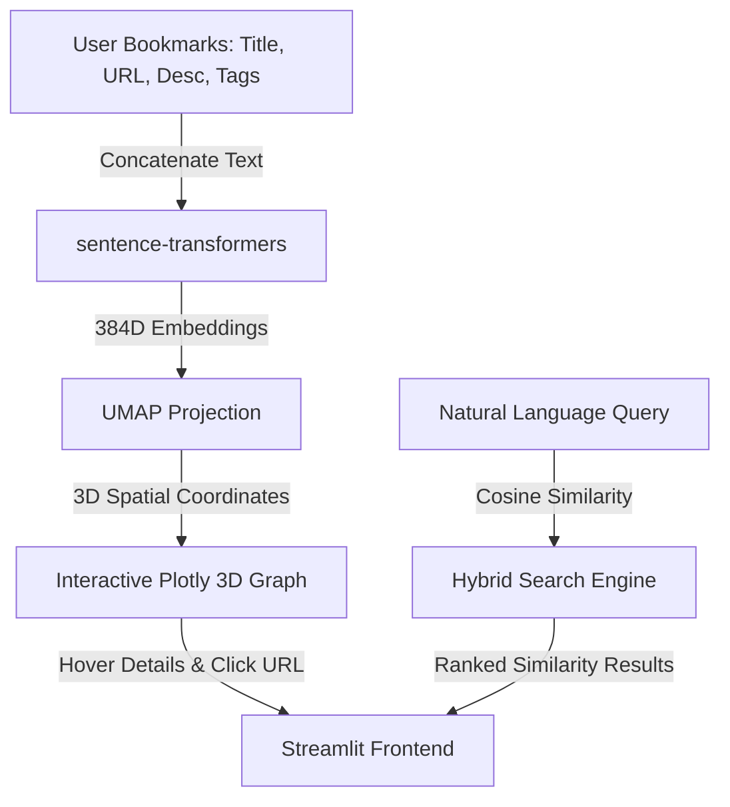
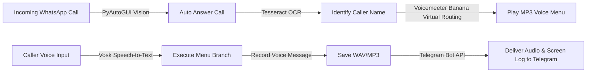
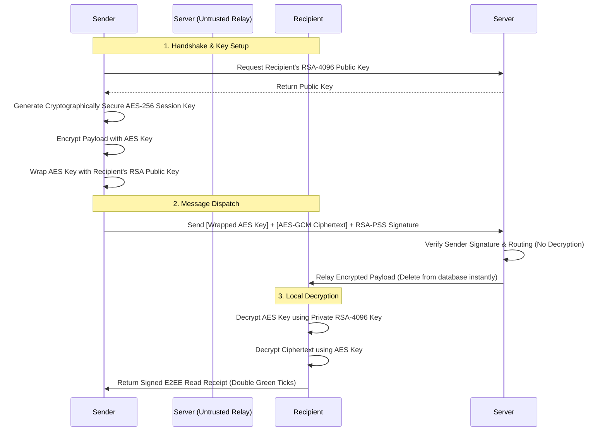

# Hi there, I'm Ali Erkin Avcı 👋

  

---

## 🚀 About Me

I am a Computer Engineering graduate dedicated to building highly secure, intelligent, and automated software ecosystems. My technical expertise spans across:
* **Zero-Knowledge Cryptographic Protocols** & P2P networking architectures.
* **Deep Learning & Computer Vision** (MediaPipe attention tracking, OCR parsing).
* **Sensor-Fusion Mobile Applications** (GPS-IMU calibration & drift mitigation).
* **Intelligent RPA & Web Automation** (Playwright-stealth and anti-bot bypassing).
* **SaaS & Serverless Cloud Infrastructures** (Next.js, .NET Core, FastAPI, Supabase).

I specialize in creating clean, robust, and cost-efficient architectures (often utilizing serverless free tiers or local execution models like LM Studio).

---

## 📊 GitHub Analytics

  
  

---

## 🛠️ Tech Stack & Tools

### 💻 Languages

  
  
  
  
  
  
  
  
  
  

### ⚙️ Frameworks & Backend

  
  
  
  
  
  
  
  
  
  

### 🗄️ Databases & Hosting

  
  
  
  
  
  
  
  
  
  

### 🔧 DevOps, Automation & Security

  
  
  
  
  
  
  
  

### 🧠 AI, Machine Learning & NLP

  
  
  
  
  

---

## 🌌 Core Projects Showcase

### 1. 🌌 [Semantic Galaxy](https://github.com/erkinavcii/SematicGalaxyContext) (AI & Semantic Knowledge Graph)
A new-generation personal knowledge management system that uses machine learning to analyze saved bookmarks, structure associations, and project them into an interactive 3D semantic space.

*   **Machine Learning Pipeline:** Utilizes `sentence-transformers` (`all-MiniLM-L6-v2`) to generate 384-dimensional dense vector embeddings of bookmark descriptions and tags.
*   **Dimensionality Reduction:** Applies `UMAP` (Uniform Manifold Approximation and Projection) to project the high-dimensional vectors into interactive 3D coordinates.
*   **Interactive Spatial UI:** Plotly-based dark-mode 3D scatter graph running inside Streamlit, displaying clusters of semantically related bookmarks together.
*   **Hybrid Search Engine:** Allows querying in natural language (e.g., *"music making robots"*) combined with multi-select tag filters (AND/OR logic) and similarity progress bars.
*   **Turkish NLP Optimization:** Custom word cloud and statistics module with native Turkish stopwords filtering.

---

### 2. 📞 [WhatsApp VoIP IVR Automation](https://github.com/erkinavcii/WhatsappAssistant) (Desktop RPA & Audio Routing)
A serverless, desktop-level Interactive Voice Response (IVR) bot and answering machine designed for WhatsApp Desktop that operates without official API hooks.

*   **Computer Vision Interceptor:** Uses PyAutoGUI template matching to detect and automatically answer incoming WhatsApp voice calls in real-time.
*   **OCR Caller Recognition:** Captures caller metadata dynamically off the screen using Tesseract-OCR to log caller identity.
*   **Local Speech-to-Text (STT):** Integrates offline Turkish Vosk models to process voice commands (e.g., answering *"yes/no"* or selecting menu digits via voice).
*   **Hardware Virtual Audio Pipeline:** Dynamically routes application playbacks and mic inputs using Voicemeeter Banana virtual drivers, resolving audio loopback and acoustic echo issues.
*   **Telegram Media Pipeline:** Auto-records calls, converts to compressed MP3/WAV format, and posts both the audio recording and the call-time OCR screenshot to a target Telegram channel.

---

### 3. 🔐 [HybridP2P-Messenger](https://github.com/erkinavcii/HybridP2P-Messenger) (Zero-Knowledge E2EE Chat)
A lightweight hybrid peer-to-peer messaging application designed to secure communications against network surveillance and active relay server compromises.

*   **End-to-End Encryption:** Secured with local RSA-4096 asymmetric handshakes and AES-256-GCM symmetric session wrapping. Private keys never leave the user's physical device.
*   **E2EE WebRTC Calls:** Implements STUN-first direct peer-to-peer UDP WebRTC audio/video calling. Automatically negotiates zero-knowledge TURN relay streams if symmetric firewalls are active.
*   **O(1) Scale Group Cryptography:** Shared Group Symmetric Keys with a dynamic rekeying protocol, enforcing strict Forward Secrecy on member leave/removal by regenerating and redistributing keys to remaining members via wrapped RSA envelopes.
*   **Passwordless Signature Auth:** Secure challenge-response handshakes on WebSocket endpoints, with all state-modifying API requests authenticated using custom request-bound RSA-PSS signature headers (`X-Timestamp`, `X-Signature`).
*   **Cross-Platform Parity:** Desktop client written in Python Flet (Flutter engine) and a serverless Web client served via FastAPI utilising the browser WebCrypto API.

---

## 📂 Featured Applications Grid

<table width="100%">
  <tr>
    <td width="50%" valign="top">
      <h3>🛡️ <a href="https://github.com/erkinavcii/FamilyPulse">FamilyPulse</a></h3>
      
<b>Safety Tracking App for Children, Elderly & Neurodivergent Individuals</b>

      <ul>
        <li><b>Live Mapping:</b> Dynamic OpenStreetMap rendering utilizing <i>flutter_map</i> with active connection indicators and stale-location warnings (>30 min delay).</li>
        <li><b>Multi-Mode GPS:</b> WorkManager periodic background tasks (~15m interval) + aggressive foreground tracking service (~3m interval).</li>
        <li><b>Smart Geofencing:</b> Safe Zones (50m–1km radius) with a 30m hysteresis buffer to prevent border-bounce notification spam.</li>
        <li><b>Remote Bypass:</b> Remote audio unmute and system DND bypass to locate lost phones.</li>
        <li><b>ML Vitals & Reports:</b> Bento-style health dashboard tracking smartwatch heart rate anomalies against age/weight baselines.</li>
      </ul>
      

        
        
        
      

    </td>
    <td width="50%" valign="top">
      <h3>🏃‍♂️ <a href="https://github.com/erkinavcii/Running_Tracker">Running Tracker (Kinetics)</a></h3>
      
<b>GPS-Anchored Sensor Fusion Running Coach</b>

      <ul>
        <li><b>Sensor Fusion:</b> Smooths 1Hz hardware GPS location checks using high-frequency (50Hz) accelerometer values.</li>
        <li><b>Drift Mitigation:</b> Eliminates smartphone integration drift errors by using GPS as the distance source of truth, reserving the accelerometer for instant start detection and visual UI speed interpolation.</li>
        <li><b>Detailed Telemetry:</b> Logs real-time speed, distance, and 3-axis G-force magnitude to local CSV logs for run reviews.</li>
        <li><b>Gamified Roadmaps:</b> Achievement engines, speed gradient maps, and world-record benchmark comparisons.</li>
      </ul>
      

        
        
        
      

    </td>
  </tr>
  <tr>
    <td width="50%" valign="top">
      <h3>📈 <a href="https://github.com/erkinavcii/Pulsify">Pulsify</a></h3>
      
<b>AI-Powered Operations Dashboard & Assistant for SMEs</b>

      <ul>
        <li><b>Turkish NLP:</b> Real-time AI chatbot executing CRUD orders, checking inventory, and detecting shipment delays via natural language processing.</li>
        <li><b>Automated Executive Reporting:</b> Google Gemini API generates consolidated operation summaries, customer sentiment metrics, and stock warnings.</li>
        <li><b>Cargo Delay Detection:</b> Real-time shipment log scanning and proactive alert queues.</li>
        <li><b>Slick Dashboard:</b> Styled React interface utilizing Zustand state and fully async Motor MongoDB routing.</li>
      </ul>
      

        
        
        
      

    </td>
    <td width="50%" valign="top">
      <h3>🕵️ <a href="https://github.com/erkinavcii/IDataBot">IDataBot</a></h3>
      
<b>Stateful iDATA Visa Appointment Tracker</b>

      <ul>
        <li><b>Anti-Bot Bypassing:</b> Integrates <code>playwright-stealth</code> to bypass Cloudflare, Turnstile, and Akamai barriers using human-like mouse movements.</li>
        <li><b>Persistent Login Session:</b> Cookie storage logic avoids re-authenticating on every launch.</li>
        <li><b>Self-Healing Workflows:</b> Detects server timeout errors or page refreshes, automatically resets form selectors, and continues scanning.</li>
        <li><b>Sound Alerts:</b> Triggers specific multi-tone Windows system sound alerts when a visa slot opens.</li>
      </ul>
      

        
        
        
      

    </td>
  </tr>
  <tr>
    <td width="50%" valign="top">
      <h3>🎙️ <a href="https://github.com/erkinavcii/SesliAsistan">SesliAsistan</a></h3>
      
<b>Conversational Real Estate Lead Persuasion Agent</b>

      <ul>
        <li><b>Local LLMs:</b> Conversational AI integrating Llama/Mistral locally via LM Studio, running personalized lead follow-ups.</li>
        <li><b>Gemini Live Integration:</b> Live voice persuasion module using Gemini Live V2 APIs for human-sounding customer negotiation.</li>
        <li><b>Stateful Objection Management:</b> Scripted logical gates handling price, location, and urgency objections.</li>
        <li><b>Reporting Pipeline:</b> Outputs JSON conversation logs and generates daily conversion analytics.</li>
      </ul>
      

        
        
        
      

    </td>
    <td width="50%" valign="top">
      <h3>👁️ <a href="https://github.com/erkinavcii/Study-Tracker">Smart Focus Assistant</a></h3>
      
<b>Computer-Vision Screen Attention Tracker</b>

      <ul>
        <li><b>Eye/Iris Tracking:</b> Computes real-time screen-attention metrics via local webcam streams using MediaPipe Iris mesh.</li>
        <li><b>Active App Filters:</b> Hooks Windows OS active window titles, matching them against whitelisted (work) and blacklisted (distractions).</li>
        <li><b>Focus Ratio:</b> Aggregates screen visual alignment and window checks into a live productivity score.</li>
        <li><b>Telemetry DB:</b> Logs work sessions, focus ratios, and distraction events to SQLite.</li>
      </ul>
      

        
        
        
      

    </td>
  </tr>
  <tr>
    <td width="50%" valign="top">
      <h3>🔑 <a href="https://github.com/erkinavcii/CevizWebsitesi">Ceviz Bahçesi (D2C)</a></h3>
      
<b>Direct-to-Consumer Organic Walnut E-Commerce & Logistics</b>

      <ul>
        <li><b>Serverless Database:</b> Connects Neon.tech PostgreSQL with Next.js API Routes to achieve a zero-cost server hosting model.</li>
        <li><b>Real-Time Inventory:</b> Automatic variant stock calculations (e.g., 500g/1kg/5kg packages) with low-stock threshold triggers.</li>
        <li><b>n8n Orchestration:</b> Automation pipelines firing SMS (Netgsm), invoices (Paraşüt API), and real-time order alerts to Telegram.</li>
        <li><b>Secure Payments:</b> Integrates sandbox & production Iyzico 3D Secure checkout.</li>
      </ul>
      

        
        
        
      

    </td>
    <td width="50%" valign="top">
      <h3>🏠 <a href="https://github.com/erkinavcii/CustomerRegistration">AvcıVilla (HiringCalendar)</a></h3>
      
<b>Vacation Villa Reservation & Availability Hub</b>

      <ul>
        <li><b>iCal Sync Motor:</b> A zero-dependency custom parser syncing Airbnb, Booking.com, and VRBO calendars in real-time, built around core Node.js SSR streams.</li>
        <li><b>Supabase RLS:</b> Table-level security ensuring public visitors only see blocked calendar dates, while client metadata, reservation notes, and rental pricing are kept admin-only.</li>
        <li><b>WhatsApp Lead Generator:</b> Computes totals dynamically and constructs preset booking request chat templates.</li>
        <li><b>Analytics Admin Panel:</b> Tracks seasonal occupancies, booking stats, and multi-currency income estimations.</li>
      </ul>
      

        
        
        
      

    </td>
  </tr>
  <tr>
    <td width="50%" valign="top">
      <h3>⏱️ <a href="https://github.com/erkinavcii/WindowsShuttimer">AutoOff (ShutTimer)</a></h3>
      
<b>Fluent Win11 styled Smart PC Shutdown Overlay</b>

      <ul>
        <li><b>Aggressive Countdowns:</b> Displays a full-screen, top-level warning dialog with sirens 60s before shutting down, allowing quick aborts.</li>
        <li><b>WinAPI Sleep Workaround:</b> Uses PowerShell execution hooks to bypass standard Windows sleep issues (e.g., going into hibernation instead of clean sleep).</li>
        <li><b>Hardware Activity Triggers:</b> Monitors active network download speeds and CPU utilization triggers, postponing shutdown tasks until active processes complete.</li>
      </ul>
      

        
        
        
      

    </td>
    <td width="50%" valign="top">
      <h3>🎵 <a href="https://github.com/erkinavcii/LyraApp-Pair">LyraApp</a></h3>
      
<b>Material 3 Online/Offline Music Player for Android</b>

      <ul>
        <li><b>MVI Pattern:</b> Implements strict Model-View-Intent data flow with clean separate contract interfaces.</li>
        <li><b>Local/Cloud Sync:</b> Connects with backend REST APIs for online playback, caching audio tracks locally for offline use.</li>
        <li><b>Jetpack Compose UI:</b> Fluent audio visualizers, dynamic backgrounds, and custom playback controls.</li>
      </ul>
      

        
        
        
      

    </td>
  </tr>
  <tr>
    <td width="50%" valign="top">
      <h3>🏨 <a href="https://github.com/erkinavcii/otel-projesi">OtelApp</a></h3>
      
<b>Full-Stack Airbnb-Style Property Booking Platform</b>

      <ul>
        <li><b>Complete REST API:</b> Django REST Framework backend with three independent domain modules: <code>properties</code>, <code>bookings</code>, and <code>pricing</code>.</li>
        <li><b>Cloud Media Storage:</b> Cloudinary + AWS S3/boto3 integration for property image management and CDN delivery.</li>
        <li><b>Admin Dashboard:</b> Django Jazzmin-powered admin panel with full reservation, pricing, and property management capabilities.</li>
        <li><b>Production-Ready:</b> Gunicorn WSGI server + WhiteNoise static file serving, configured for immediate cloud deployment.</li>
      </ul>
      

        
        
        
        
      

    </td>
    <td width="50%" valign="top">
      <h3>🚀 <a href="https://github.com/erkinavcii/Pythonsolanabot">Solana Sniper Bot V18</a></h3>
      
<b>High-Speed DeFi Trading Bot for Solana Meme Coins</b>

      <ul>
        <li><b>Sub-Second Execution:</b> Monitors Telegram signal channels via regex parsing and fires buy orders through Jupiter V6 API within milliseconds of a signal.</li>
        <li><b>Rugcheck & Honeypot Shield:</b> Automatically screens tokens via Rugcheck API before purchase, eliminating unsellable and rug-pull-risk assets.</li>
        <li><b>Dual Exit Strategies:</b> Supports Direct TP/SL (fixed targets) and Trailing Stop (peak-tracking) modes for both conservative and moonshot trading scenarios.</li>
        <li><b>Remote Command Center:</b> Built-in Telegram command interface (<code>/status</code>, <code>/panic</code>, <code>/buy</code>) for live position management and PNL reporting.</li>
      </ul>
      

        
        
        
        
      

    </td>
  </tr>
</table>

---

## 📁 Other Repositories

  
🎓 <b>View Academic & Coursework Repositories</b>

*   **[Fatura-Takip-Uygulamas-Billing-Tracker-PWA-](https://github.com/erkinavcii/Fatura-Takip-Uygulamas-Billing-Tracker-PWA-)**: Serverless Progressive Web App designed to track monthly or recurring bills with local browser storage and notification alerts. *(HTML5 / CSS3 / Tailwind CSS / Vanilla JS)*
*   **[deprem-bot](https://github.com/erkinavcii/deprem-bot)**: A serverless earthquake notification bot running on GitHub Actions cron tasks, filtering coordinates using the Haversine formula and generating static map images (Geoapify) for Telegram warnings. *(Python)*
*   **[KariyerKapisiBot](https://github.com/erkinavcii/KariyerKapisiBot)**: Automated session manager tracking application updates on the Turkish Government career gate website. *(Python)*
*   **[Turkcellgygy5-kotlin-bankac-l-k](https://github.com/erkinavcii/Turkcellgygy5-kotlin-bankac-l-k)**: A Kotlin mobile banking console application model developed for the Turkcell GYGY Bootcamp. *(Kotlin)*
*   **[CustomerRegistration](https://github.com/erkinavcii/CustomerRegistration)** & **[OopLab](https://github.com/erkinavcii/OopLab)**: Coursework directories utilizing ASP.NET Core MVC, Entity Framework, MSSQL localdb, and JWT Bearer authorization tests. *(C# / .NET)*
*   **[AygazYapayZeka](https://github.com/erkinavcii/AygazYapayZeka)**: Visualizations and notebooks detailing the Aygaz AI Literacy program. *(Jupyter Notebook)*

---

## 📫 Connect with Me

  
  

