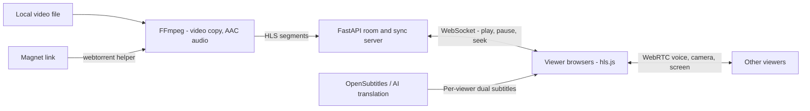
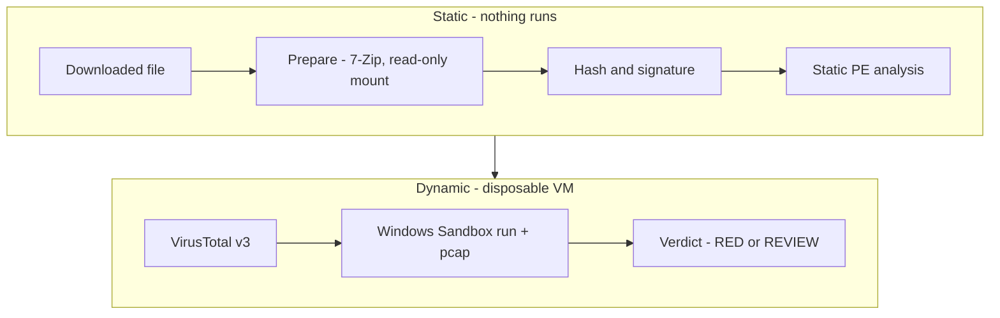
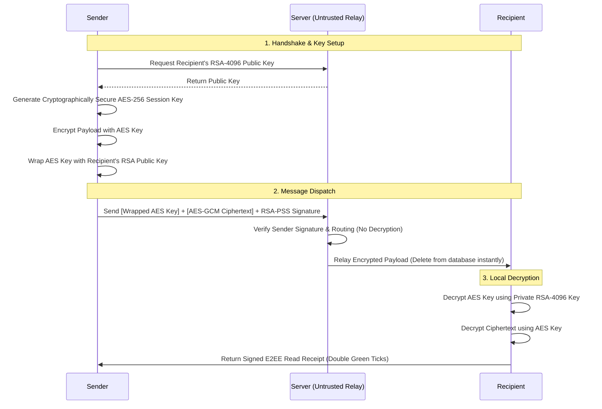
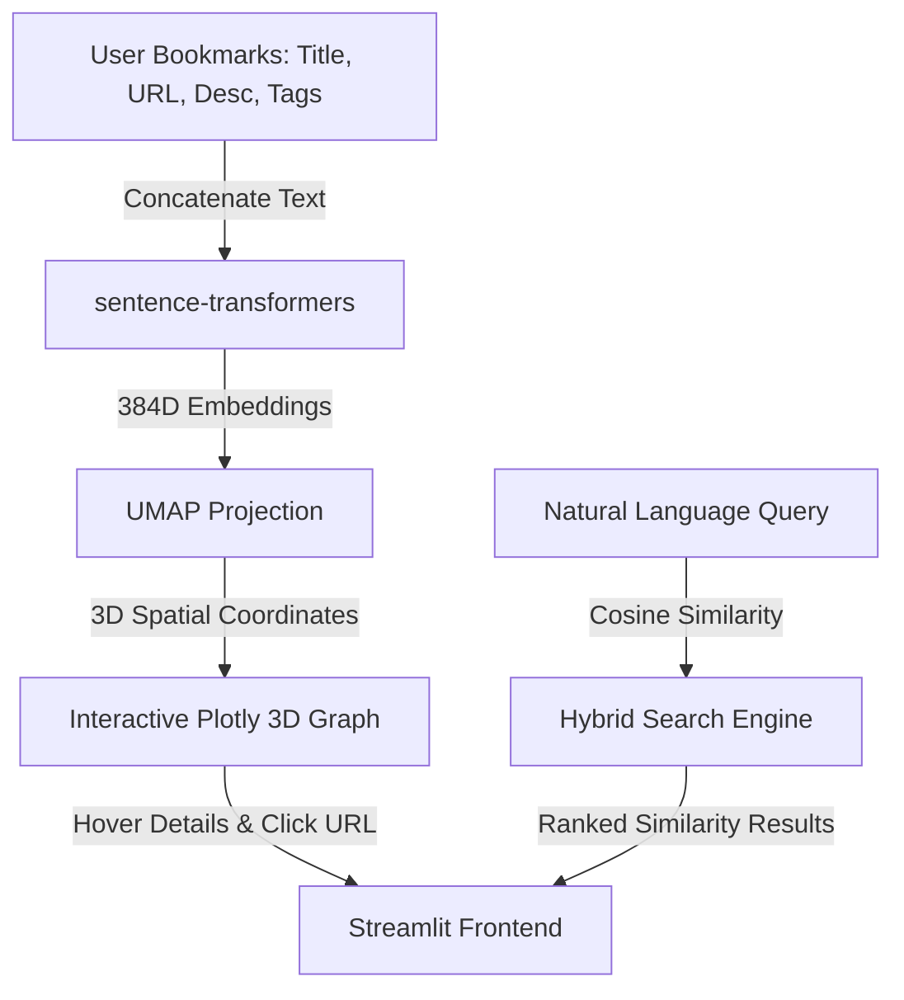

# Hi there, I'm Ali Erkin Avcı 👋

  

---

## 🚀 About Me

I am a Computer Engineering graduate dedicated to building highly secure, intelligent, and automated software ecosystems. My technical expertise spans across:
* **Zero-Knowledge Cryptographic Protocols** & P2P networking architectures.
* **Deep Learning & Computer Vision** (MediaPipe attention tracking, OCR parsing).
* **Sensor-Fusion Mobile Applications** (GPS-IMU calibration & drift mitigation).
* **Intelligent RPA & Web Automation** (Playwright-stealth and anti-bot bypassing).
* **SaaS & Serverless Cloud Infrastructures** (Next.js, .NET Core, FastAPI, Supabase).

I specialize in creating clean, robust, and cost-efficient architectures (often utilizing serverless free tiers or local execution models like LM Studio).

---

## 📊 GitHub Analytics

  
  

---

## 🛠️ Tech Stack & Tools

### 💻 Languages

  
  
  
  
  
  
  
  
  
  

### ⚙️ Frameworks & Backend

  
  
  
  
  
  
  
  
  
  
  
  
  
  

### 🗄️ Databases & Hosting

  
  
  
  
  
  
  
  
  
  
  

### 🔧 DevOps, Automation & Security

  
  
  
  
  
  
  
  
  
  
  
  
  
  

### 🧠 AI, Machine Learning & NLP

  
  
  
  
  
  
  
  
  
  

---

## 🌌 Core Projects Showcase

### 1. 🎬 [Co-Watch](https://github.com/erkinavcii/CoWatch) · [⬇️ Windows Installer](https://github.com/erkinavcii/CoWatch/releases/latest) (Self-Hosted Watch Party & Real-Time Sync)
Watch the same film with friends far away while **everyone picks their own subtitle languages** (you TR + EN, your friend RU + EN). The host's local file or torrent is streamed in original quality — no upload, no account, no rented server.

*   **Lossless HLS Pipeline:** FFmpeg copies the video stream untouched (audio → AAC stereo) into HLS; magnet links are streamed through a Node `webtorrent` helper that fetches the container header/index first, then pieces in playback order.
*   **Server-Authoritative Sync:** A FastAPI WebSocket room is the single source of truth (`playing`, `position`, `updatedAt`). Clients drifting > 1 s seek; 0.1–1 s drift is corrected smoothly by ±5 % playback rate. The room waits for stalled viewers until they have 4 s buffered.
*   **Personal Dual Subtitles:** Subtitles are never burned in — each browser renders its own main + secondary track against the film clock, with per-track offsets. Subtitles are cached by OpenSubtitles hash; legacy encodings (`cp1254`, `cp1251`) are auto-fixed; missing languages can be translated by LLMs (cloud or local Ollama / LM Studio).
*   **Together, not just synced:** P2P WebRTC voice, camera and screen sharing, live pointers and a drawing pen anchored to the same spot of the frame on every screen.
*   **Zero-Config Sharing:** Tailscale Serve / Funnel gives friends one HTTPS link; a tray app + Inno Setup installer bundles FFmpeg and Node. Covered by a CI test workflow on GitHub Actions.

---

### 2. 🧪 [SafeBox — Malware Triage Pipeline](https://github.com/erkinavcii/wsb-triage) (Security Tooling & Dynamic Analysis)
A local web panel that inspects a downloaded file **before** it ever runs on the host — static analysis, reputation lookup and detonation inside a disposable Windows Sandbox, ending in a single verdict.

*   **Static Analysis:** SHA-256 + Authenticode checks, PE header inspection, entropy, suspicious API imports and stealer / Telegram / Discord / anti-VM indicators on the 40 most suspicious files. Archives (RAR, encrypted, multi-part) are extracted with 7-Zip — nothing is executed at this stage.
*   **Quota-Aware VirusTotal v3:** Hash lookups first (known malware surfaces instantly), then uploads of unknown files up to 650 MB, with automatic free-tier rate-limit back-off.
*   **Hardened Dynamic Analysis:** Generated `.wsb` configs mount the sample read-only with clipboard, vGPU, printer, mic and camera disabled. An in-sandbox PowerShell monitor records new processes, connections, services, scheduled tasks, autoruns, Defender/hosts/firewall changes and dropped files; traffic is captured to `pcapng` via `pktmon`.
*   **LAN Isolation with Tamper Detection:** A firewall rule blocks the home network and host from inside the sandbox; it is re-verified every 5 s and a removal re-applies it and raises a **RED** flag.
*   **Safe-by-Default Panel:** Binds to `127.0.0.1` only and rejects cross-origin requests via `Origin` / `Sec-Fetch-Site` checks (CSRF and DNS-rebinding protection). Results are classified **RED / REVIEW** with a Markdown report and Wireshark-based DNS/TLS/HTTP summary.

---

### 3. 🔐 [HybridP2P-Messenger](https://github.com/erkinavcii/HybridP2P-Messenger) (Zero-Knowledge E2EE Chat)
A lightweight hybrid peer-to-peer messaging application designed to secure communications against network surveillance and active relay server compromises.

*   **End-to-End Encryption:** Secured with local RSA-4096 asymmetric handshakes and AES-256-GCM symmetric session wrapping. Private keys never leave the user's physical device.
*   **E2EE WebRTC Calls:** Implements STUN-first direct peer-to-peer UDP WebRTC audio/video calling. Automatically negotiates zero-knowledge TURN relay streams if symmetric firewalls are active.
*   **O(1) Scale Group Cryptography:** Shared Group Symmetric Keys with a dynamic rekeying protocol, enforcing strict Forward Secrecy on member leave/removal by regenerating and redistributing keys to remaining members via wrapped RSA envelopes.
*   **Passwordless Signature Auth:** Secure challenge-response handshakes on WebSocket endpoints, with all state-modifying API requests authenticated using custom request-bound RSA-PSS signature headers (`X-Timestamp`, `X-Signature`).
*   **Cross-Platform Parity:** Desktop client written in Python Flet (Flutter engine) and a serverless Web client served via FastAPI utilising the browser WebCrypto API.
*   **Serverless "Walkie-Talkie" Mode:** Two online devices can connect with no server at all by exchanging one-time codes (copy-paste or QR) signed with the identity key and bound to the WebRTC/DTLS session, so a tampered or impersonated code is detected. Supports chat, voice/video and SHA-256-verified file transfer up to 1 GB — from the desktop, a single self-contained `serverless.html` whose CSP blocks every request except WebRTC, or an Android app (ZXing QR scanning, no Google services).

---

### 4. 🌌 [Semantic Galaxy](https://github.com/erkinavcii/SematicGalaxyContext) · [🌐 Live Demo](https://sematicgalaxycontext-ysbtyhl4rqg7ijsja43fs4.streamlit.app/) (AI & Semantic Knowledge Graph)
A new-generation personal knowledge management system that uses machine learning to analyze saved bookmarks, structure associations, and project them into an interactive 3D semantic space.

*   **Machine Learning Pipeline:** Utilizes `sentence-transformers` (`all-MiniLM-L6-v2`) to generate 384-dimensional dense vector embeddings of bookmark descriptions and tags.
*   **Dimensionality Reduction:** Applies `UMAP` (Uniform Manifold Approximation and Projection) to project the high-dimensional vectors into interactive 3D coordinates.
*   **Interactive Spatial UI:** Plotly-based dark-mode 3D scatter graph running inside Streamlit, displaying clusters of semantically related bookmarks together.
*   **Hybrid Search Engine:** Allows querying in natural language (e.g., *"music making robots"*) combined with multi-select tag filters (AND/OR logic) and similarity progress bars.
*   **Turkish NLP Optimization:** Custom word cloud and statistics module with native Turkish stopwords filtering.

---

## 📂 Featured Applications Grid

<table width="100%">
  <tr>
    <td width="50%" valign="top">
      <h3>🚗 <a href="https://github.com/erkinavcii/Rencar">Rencar</a></h3>
      
<b>Car-Sharing Android App with On-Device AI Verification</b> Team project · Turkcell GYGY-5

      <ul>
        <li><b>On-Device Face Matching:</b> Driver's-licence photo vs. live selfie verification with Google ML Kit + TensorFlow Lite — no biometric data leaves the phone.</li>
        <li><b>Live Vehicle Tracking:</b> Socket.IO position stream with linear interpolation for smooth movement on a MapLibre map.</li>
        <li><b>Server-Synced Rental Lifecycle:</b> <code>PREPARING → ACTIVE → COMPLETED</code> with per-minute / hourly / daily plans, live fare and before/after vehicle photos.</li>
        <li><b>Real Payments:</b> Iyzico sandbox checkout with wallet or card; MVI + unidirectional data flow, Hilt and the Repository pattern.</li>
      </ul>
      

        
        
        
        
      

    </td>
    <td width="50%" valign="top">
      <h3>🛡️ FamilyPulse</h3>
      
<b>Safety Tracking App for Children, Elderly & Neurodivergent Individuals</b>

      <ul>
        <li><b>Live Mapping:</b> Dynamic OpenStreetMap rendering utilizing <i>flutter_map</i> with active connection indicators and stale-location warnings (>30 min delay).</li>
        <li><b>Multi-Mode GPS:</b> WorkManager periodic background tasks (~15m interval) + aggressive foreground tracking service (~3m interval).</li>
        <li><b>Smart Geofencing:</b> Safe Zones (50m–1km radius) with a 30m hysteresis buffer to prevent border-bounce notification spam.</li>
        <li><b>Remote Bypass:</b> Remote audio unmute and system DND bypass to locate lost phones.</li>
        <li><b>Route Playback:</b> 14-day location history replayed on the map; one bucketed Firestore document per day with a 150 m distance filter and server-side TTL expiry. Legs over 400 m are drawn dashed — the map never claims a path it didn't sample.</li>
        <li><b>Weekly Bento Report:</b> Battery profile, screen sessions and safe-zone entries/exits summarised weekly. Smartwatch vitals are planned for V2.</li>
      </ul>
      

        
        
        
        
      

    </td>
  </tr>
  <tr>
    <td width="50%" valign="top">
      <h3>📞 SmartDesk IVR (WhatsApp Voice Assistant v2)</h3>
      
<b>Server-Side WhatsApp Answering Machine — Ground-Up Rewrite</b>

      <ul>
        <li><b>v1 → v2 Evolution:</b> v1 was a Windows desktop RPA (PyAutoGUI template matching, Tesseract OCR, Voicemeeter, offline Vosk STT). v2 rebuilds it for repeatable per-customer deployment on Linux with Docker.</li>
        <li><b>Deterministic Call Detection:</b> Android UI tree + activity state via ADB replace screen-template guessing; caller names come from UI text instead of OCR.</li>
        <li><b>Echo-Free Audio by Design:</b> A PulseAudio null-sink gives a one-way digital audio path — no virtual mixer, no reboot, no "mute mic" hack.</li>
        <li><b>Reliable Delivery:</b> Recordings and summaries go to Telegram via the plain Bot API with retries and an on-disk queue that survives network outages.</li>
        <li><b>Gated Rollout:</b> Phased plan with an explicit hardware go/no-go gate before production.</li>
      </ul>
      

        
        
        
        
      

    </td>
    <td width="50%" valign="top">
      <h3>🎙️ Emlak Voice Agent</h3>
      
<b>Turkish Real-Estate Voice Agent — One Goal, Four Architectures</b>

      <ul>
        <li><b>Goal:</b> Talks with property owners in Turkish to book an office meeting or bring the listing into the agency's portfolio.</li>
        <li><b>Classic Pipeline:</b> Microphone → Groq Whisper STT → Groq LLM → Edge-TTS, validated end to end with real APIs.</li>
        <li><b>Gemini Live:</b> Native audio-to-audio conversation with low latency and barge-in, as a Python terminal agent and a React + Vite app with listings and a calendar; the API key stays on the server, which mints short-lived tokens for the browser.</li>
        <li><b>Real Phone Calls:</b> Batch outbound calling through a Vapi assistant on a Twilio number, fed by a CSV format shared by all four versions.</li>
        <li><b>Responsible by Design:</b> The agent always discloses that it is an AI; KVKK / İYS consent is required before calling real people.</li>
      </ul>
      

        
        
        
        
      

    </td>
  </tr>
  <tr>
    <td width="50%" valign="top">
      <h3>🚀 Solana Sniper Bot V21</h3>
      
<b>Latency-Critical Trading Bot with Quota-Aware Execution</b>

      <ul>
        <li><b>Signal → Swap:</b> Regex-parses Telegram signal channels, screens each token with Rugcheck (honeypots, unlocked liquidity) and buys through the Jupiter Swap API.</li>
        <li><b>Priority Rate Limiter:</b> The keyless Jupiter quota (5 requests / 10 s) is shared by price, quote and swap. Buys, sells and exit checks get a reserved priority lane while routine PnL polling is skipped when the quota is out — the HTTP 429 rate fell from 44–59 % in V20 to 0 % in dry-run measurement.</li>
        <li><b>Verified Exits:</b> Per-second prices from the most liquid SOL pair on DexScreener; when a TP / SL / trailing threshold trips, real PnL is confirmed with a high-priority quote, and transactions are confirmed by racing WebSocket against HTTP polling.</li>
        <li><b>Tested Before Trusted:</b> 57/57 offline unit tests, live API schema tests and a <code>DRY_RUN</code> mode; Telegram <code>/status</code>, <code>/panic</code>, <code>/buy</code> commands and a JSON trade log. Live transactions are not yet tested on V21.</li>
      </ul>
      

        
        
        
        
      

    </td>
    <td width="50%" valign="top">
      <h3>🔥 <a href="https://github.com/erkinavcii/Sicakfirsatlar-indirim-takip">Smart Deal Tracker</a></h3>
      
<b>Forum Deal Scraper with Turkish NLP & AI Price Verification</b>

      <ul>
        <li><b>Async Scraping:</b> Asynchronous pipeline over XenForo deal forums that skips expired deals via thread prefixes.</li>
        <li><b>Turkish Stemmer:</b> A custom normalizer strips inflectional suffixes and reverses consonant softening (<i>kulaklığı → kulaklık</i>, <i>bebeği → bebek</i>) so keyword filters don't miss agglutinated forms.</li>
        <li><b>AI Verification Mode:</b> Gemini extracts clean product/price via Pydantic structured output, then checks real market prices with Google Search Grounding — only deals ≥ 10 % below market are kept.</li>
        <li><b>Dual-Mode:</b> Runs fully locally without an API key; FastAPI dashboard + Telegram alerts.</li>
      </ul>
      

        
        
        
      

    </td>
  </tr>
  <tr>
    <td width="50%" valign="top">
      <h3>❄️ <a href="https://github.com/erkinavcii/IR-AC-Timer">IR AC Timer</a></h3>
      
<b>Set-&-Forget Air Conditioner Shutdown via the Phone's IR Blaster</b>

      <ul>
        <li><b>Flutter + Native Kotlin:</b> Flutter UI; IR hardware access (<code>ConsumerIrManager</code>) and scheduling written natively and bridged over a <code>MethodChannel</code>.</li>
        <li><b>Doze-Proof Timing:</b> <code>setExactAndAllowWhileIdle</code> alarms fire on time even in deep sleep; <code>BOOT_COMPLETED</code> restores tasks after a reboot.</li>
        <li><b>Countdown & Cycle Modes:</b> One-shot timers or a cycle mode that re-sends the signal every X minutes within an optional time window, with per-brand AC IR code profiles.</li>
        <li><b>OEM Hardening:</b> Explicit handling of Xiaomi / MIUI / HyperOS background-kill behaviour; Kotlin unit tests for the scheduler.</li>
      </ul>
      

        
        
        
      

    </td>
    <td width="50%" valign="top">
      <h3>🏃‍♂️ <a href="https://github.com/erkinavcii/Running_Tracker">Running Tracker (Kinetics)</a></h3>
      
<b>GPS-Anchored Sensor Fusion Running Coach</b>

      <ul>
        <li><b>Sensor Fusion:</b> Smooths 1Hz hardware GPS location checks using high-frequency (50Hz) accelerometer values.</li>
        <li><b>Drift Mitigation:</b> Eliminates smartphone integration drift errors by using GPS as the distance source of truth, reserving the accelerometer for instant start detection and visual UI speed interpolation.</li>
        <li><b>Detailed Telemetry:</b> Logs real-time speed, distance, and 3-axis G-force magnitude to local CSV logs for run reviews.</li>
        <li><b>Gamified Roadmaps:</b> Achievement engines, speed gradient maps, and world-record benchmark comparisons.</li>
      </ul>
      

        
        
        
      

    </td>
  </tr>
  <tr>
    <td width="50%" valign="top">
      <h3>👁️ Smart Focus Assistant</h3>
      
<b>Computer-Vision Screen Attention Tracker</b>

      <ul>
        <li><b>Eye/Iris Tracking:</b> Computes real-time screen-attention metrics via local webcam streams using MediaPipe Iris mesh.</li>
        <li><b>Active App Filters:</b> Hooks Windows OS active window titles, matching them against whitelisted (work) and blacklisted (distractions).</li>
        <li><b>Focus Ratio:</b> Aggregates screen visual alignment and window checks into a live productivity score.</li>
        <li><b>Telemetry DB:</b> Logs work sessions, focus ratios, and distraction events to SQLite.</li>
      </ul>
      

        
        
        
        
      

    </td>
    <td width="50%" valign="top">
      <h3>🔑 <a href="https://github.com/erkinavcii/CevizWebsitesi">Ceviz Bahçesi (D2C)</a></h3>
      
<b>Direct-to-Consumer Organic Walnut E-Commerce & Logistics</b>

      <ul>
        <li><b>Serverless Database:</b> Connects Neon.tech PostgreSQL with Next.js API Routes to achieve a zero-cost server hosting model.</li>
        <li><b>Real-Time Inventory:</b> Automatic variant stock calculations (e.g., 500g/1kg/5kg packages) with low-stock threshold triggers.</li>
        <li><b>n8n Orchestration:</b> Automation pipelines firing SMS (Netgsm), invoices (Paraşüt API), and real-time order alerts to Telegram.</li>
        <li><b>Secure Payments:</b> Integrates sandbox & production Iyzico 3D Secure checkout.</li>
      </ul>
      

        
        
        
      

    </td>
  </tr>
  <tr>
    <td width="50%" valign="top">
      <h3>🏨 <a href="https://otel-projesi.vercel.app/">OtelApp</a></h3>
      
<b>Full-Stack Airbnb-Style Property Booking Platform</b> 

      <ul>
        <li><b>Complete REST API:</b> Django REST Framework backend with three independent domain modules: <code>properties</code>, <code>bookings</code>, and <code>pricing</code>.</li>
        <li><b>Cloud Media Storage:</b> Cloudinary + AWS S3/boto3 integration for property image management and CDN delivery.</li>
        <li><b>Admin Dashboard:</b> Django Jazzmin-powered admin panel with full reservation, pricing, and property management capabilities.</li>
        <li><b>Production-Ready:</b> Gunicorn WSGI server + WhiteNoise static file serving, configured for immediate cloud deployment.</li>
      </ul>
      

        
        
        
        
        
      

    </td>
    <td width="50%" valign="top">
      <h3>🏠 <a href="https://hiring-calendar-two.vercel.app/">AvcıVilla (HiringCalendar)</a></h3>
      
<b>Vacation Villa Reservation & Availability Hub</b> 

      <ul>
        <li><b>iCal Sync Motor:</b> A zero-dependency custom parser syncing Airbnb, Booking.com, and VRBO calendars in real-time, built around core Node.js SSR streams.</li>
        <li><b>Supabase RLS:</b> Table-level security ensuring public visitors only see blocked calendar dates, while client metadata, reservation notes, and rental pricing are kept admin-only.</li>
        <li><b>WhatsApp Lead Generator:</b> Computes totals dynamically and constructs preset booking request chat templates.</li>
        <li><b>Analytics Admin Panel:</b> Tracks seasonal occupancies, booking stats, and multi-currency income estimations.</li>
      </ul>
      

        
        
        
        
      

    </td>
  </tr>
</table>

---

## 🧩 More Projects

> 🔒 = private repository.

| Project | What it does | Stack |
|---|---|---|
| [**AI Reservation Assistant**](https://github.com/erkinavcii/Ai-Reservation-Assistant) | LLM booking agent for WhatsApp / sahibinden.com leads: slot-filling for dates and guests, natural-language date parsing, tool calling against the availability API with alternative-date offers | Python · DeepSeek · FastAPI |
| [**Pulsify**](https://github.com/cdemir7/Pulsify) | AI operations platform for SMEs — orders, shipments and customers on one screen; Gemini 2.5 Flash flags shipment delays proactively and analyses customer sentiment in real time. Team project (contributor) | FastAPI · React · MongoDB · Gemini |
| **Dongu** 🔒 | Offline-only menstrual cycle tracker that learns which symptoms *you* get per phase — no account, no server, no network calls | React Native · Expo |
| **Ekşim** 🔒 | Unofficial Android reader for Ekşi Sözlük; a Kotlin Multiplatform parser driven by a remote [`selectors.json`](https://github.com/erkinavcii/project-configs) so site changes are fixed without an app release | Kotlin · KMP |
| **Wave Defense** 🔒 | Tower defense × twin-stick hero shooter: drag-to-build walls, levelled towers, research tree, enemies that hunt the hero, code-synthesized SFX | Unity 6 · C# |
| **Gym Progress Tracker** 🔒 | Streak-driven social gym tracker with friend comparisons, 90-day heatmap and offline awareness | Flutter · Firebase |
| **SalatStreak** 🔒 | Prayer-habit tracker with a dual streak system, missed-prayer (kaza) ledger, dhikr counter, fasting log and friend leaderboards; localised in TR, EN and UR | Flutter · Firebase |
| **Rock Shop** 🔒 | In development: 1–4 player online co-op, first-person shop simulator on an asteroid, built by a small team and targeting Steam Next Fest 2027 | Unity 6 · URP · C# |
| **MenuApp** 🔒 | Digital menu SaaS for restaurants and cafés | ASP.NET Core |
| [**iDATA Visa Tracker**](https://github.com/erkinavcii/ItalyaVize) | Async Playwright appointment tracker with persistent sessions, self-healing form recovery and audio alerts | Python · Playwright |
| [**LyraApp**](https://github.com/erkinavcii/LyraApp-Pair) | Material 3 online/offline music player with strict MVI contracts | Kotlin · Jetpack Compose |
| [**AutoOff**](https://github.com/erkinavcii/WindowsShuttimer) | Win11-style shutdown overlay that postpones while downloads or CPU load are active | Python · CustomTkinter · Win32 |
| [**HealRoute AI**](https://github.com/erkinavcii/YZTA_Bootcamp_2026) | AI health-tourism and travel planner — team project, YZTA Bootcamp 2026 | Python |

---

## 📁 Other Repositories

  
🎓 <b>View Academic & Coursework Repositories</b>

*   **[Fatura-Takip-Uygulamas-Billing-Tracker-PWA-](https://github.com/erkinavcii/Fatura-Takip-Uygulamas-Billing-Tracker-PWA-)**: Serverless Progressive Web App designed to track monthly or recurring bills with local browser storage and notification alerts. *(HTML5 / CSS3 / Tailwind CSS / Vanilla JS)*
*   **[deprem-bot](https://github.com/erkinavcii/deprem-bot)**: A serverless earthquake notification bot running on GitHub Actions cron tasks, filtering coordinates using the Haversine formula and generating static map images (Geoapify) for Telegram warnings. *(Python)*
*   **[KariyerKapisiBot](https://github.com/erkinavcii/KariyerKapisiBot)**: Automated session manager tracking application updates on the Turkish Government career gate website. *(Python)*
*   **[Turkcellgygy5-kotlin-bankac-l-k](https://github.com/erkinavcii/Turkcellgygy5-kotlin-bankac-l-k)**: A Kotlin mobile banking console application model developed for the Turkcell GYGY Bootcamp. *(Kotlin)*
*   **[CustomerRegistration](https://github.com/erkinavcii/CustomerRegistration)** & **[OopLab](https://github.com/erkinavcii/OopLab)**: Coursework directories utilizing ASP.NET Core MVC, Entity Framework, MSSQL localdb, and JWT Bearer authorization tests. *(C# / .NET)*
*   **[AygazYapayZeka](https://github.com/erkinavcii/AygazYapayZeka)**: Visualizations and notebooks detailing the Aygaz AI Literacy program. *(Jupyter Notebook)*

---

## 📫 Connect with Me

  
  

