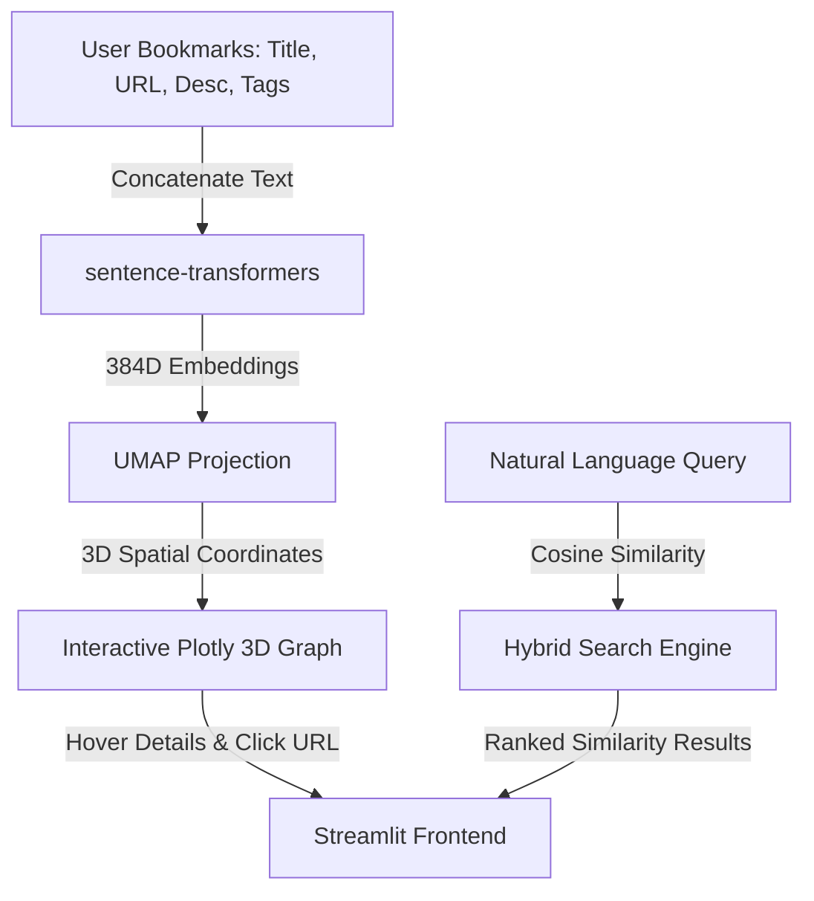
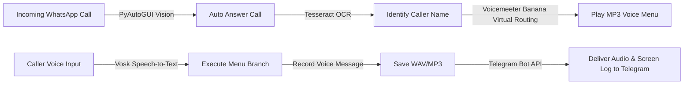
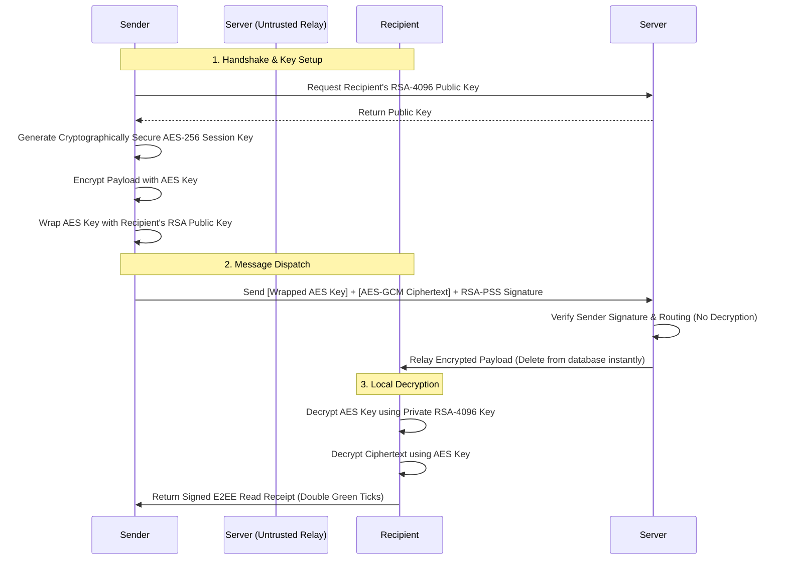

# Hi there, I'm Ali Erkin Avcı 👋

<p align="center">
  <a href="https://github.com/erkinavcii">
    
  </a>
</p>

---

## 🚀 About Me

I am a Computer Engineering graduate dedicated to building highly secure, intelligent, and automated software ecosystems. My technical expertise spans across:
* **Zero-Knowledge Cryptographic Protocols** & P2P networking architectures.
* **Deep Learning & Computer Vision** (MediaPipe attention tracking, OCR parsing).
* **Sensor-Fusion Mobile Applications** (GPS-Anchored IMU calibration).
* **Intelligent RPA & Web Automation** (Playwright-stealth and anti-bot bypassing).
* **SaaS & Serverless Infrastructures** (Next.js, FastAPI, Supabase, Neon).

I specialize in creating clean, robust, and cost-efficient architectures (often utilizing serverless free tiers or local execution models like LM Studio).

---

## 🛠️ Tech Stack & Ecosystem

```
┌────────────────────────────────────────────────────────────────────────┐
│                              LANGUAGES                                 │
│          Python  ·  TypeScript  ·  Dart  ·  Kotlin  ·  C#  ·  C++       │
├────────────────────────────────────────────────────────────────────────┤
│                          AI & MACHINE LEARNING                         │
│   Gemini API · Local LLMs (LM Studio) · sentence-transformers · UMAP   │
│               MediaPipe Attention Tracking · Vosk Speech STT           │
├────────────────────────────────────────────────────────────────────────┤
│                           WEB & CLOUD SAAS                             │
│   Next.js (14-16 App Router) · React · FastAPI · Supabase RLS · Neon   │
│             MongoDB (Motor Async) · PWA · Tailwind CSS · n8n           │
├────────────────────────────────────────────────────────────────────────┤
│                         AUTOMATION & SYSTEMS                           │
│ Playwright Stealth · PyAutoGUI · Tesseract OCR · Voicemeeter routing  │
│          Win32 API · Windows Message Subclassing · PyInstaller         │
└────────────────────────────────────────────────────────────────────────┘
```

---

## 🌌 Core Projects Showcase

### 1. 🌌 [Semantic Galaxy](https://github.com/erkinavcii/SematicGalaxyContext) (AI & Semantic Knowledge Graph)
A new-generation personal knowledge management system that uses machine learning to analyze saved bookmarks, structure associations, and project them into an interactive 3D semantic space.

*   **Machine Learning Pipeline:** Utilizes `sentence-transformers` (`all-MiniLM-L6-v2`) to generate 384-dimensional dense vector embeddings of bookmark descriptions and tags.
*   **Dimensionality Reduction:** Applies `UMAP` (Uniform Manifold Approximation and Projection) to project the high-dimensional vectors into interactive 3D coordinates.
*   **Interactive Spatial UI:** Plotly-based dark-mode 3D scatter graph running inside Streamlit, displaying clusters of semantically related bookmarks together.
*   **Hybrid Search Engine:** Allows querying in natural language (e.g., *"music making robots"*) combined with multi-select tag filters (AND/OR logic) and similarity progress bars.
*   **Turkish NLP Optimization:** Custom word cloud and statistics module with native Turkish stopwords filtering.



---

### 2. 📞 [WhatsApp VoIP IVR Automation](https://github.com/erkinavcii/WhatsappAssistant) (Desktop RPA & Audio Routing)
A serverless, desktop-level Interactive Voice Response (IVR) bot and answering machine designed for WhatsApp Desktop that operates without official API hooks.

*   **Computer Vision Interceptor:** Uses PyAutoGUI template matching to detect and automatically answer incoming WhatsApp voice calls in real-time.
*   **OCR Caller Recognition:** Captures caller metadata dynamically off the screen using Tesseract-OCR to log caller identity.
*   **Local Speech-to-Text (STT):** Integrates offline Turkish Vosk models to process voice commands (e.g., answering *"yes/no"* or selecting menu digits via voice).
*   **Hardware Virtual Audio Pipeline:** Dynamically routes application playbacks and mic inputs using Voicemeeter Banana virtual drivers, resolving audio loopback and acoustic echo issues.
*   **Telegram Media Pipeline:** Auto-records calls, converts to compressed MP3/WAV format, and posts both the audio recording and the call-time OCR screenshot to a target Telegram channel.



---

### 3. 🔐 [HybridP2P-Messenger](https://github.com/erkinavcii/HybridP2P-Messenger) (Zero-Knowledge E2EE Chat)
A lightweight hybrid peer-to-peer messaging application designed to secure communications against network surveillance and active relay server compromises.

*   **End-to-End Encryption:** Secured with local RSA-4096 asymmetric handshakes and AES-256-GCM symmetric session wrapping. Private keys never leave the user's physical device.
*   **E2EE WebRTC Calls:** Implements STUN-first direct peer-to-peer UDP WebRTC audio/video calling. Automatically negotiates zero-knowledge TURN relay streams if symmetric firewalls are active.
*   **O(1) Scale Group Cryptography:** Shared Group Symmetric Keys with a dynamic rekeying protocol, enforcing strict Forward Secrecy on member leave/removal by regenerating and redistributing keys to remaining members via wrapped RSA envelopes.
*   **Passwordless Signature Auth:** Secure challenge-response handshakes on WebSocket endpoints, with all state-modifying API requests authenticated using custom request-bound RSA-PSS signature headers (`X-Timestamp`, `X-Signature`).
*   **Cross-Platform Parity:** Desktop client written in Python Flet (Flutter engine) and a serverless Web client served via FastAPI utilising the browser WebCrypto API.



---

### 4. 🛡️ [FamilyPulse](https://github.com/erkinavcii/FamilyPulse) (Safety Tracking & ML Vitals)
A family safety and location monitoring application built for children, elderly individuals, and people with autism, optimized for zero-cost hosting.

*   **Multi-Mode Konum Servisi:** Periodic background updates using Android WorkManager (~15m ticks) and aggressive real-time tracking via Android Foreground Services (~3m ticks).
*   **Smart Geofencing:** Safe Zone geofence triggers with a customized 30m hysteresis buffer to prevent border-bounce notification spam.
*   **Emergency Bypass:** Remote audio unmute and system Do Not Disturb (DND) bypass over custom Firestore commands, letting caregivers locate silenced devices.
*   **Bento Analytics:** Weekly security summaries logging local diagnostics (battery levels, active screens) mapped to dashboard statistics using local SQLite caching.
*   **Health Dashboard:** Wear OS smartwatch vital tracking displaying real-time heart rate trends and ML anomaly warning triggers against personalized baselines.

---

### 5. 📈 [Pulsify](https://github.com/erkinavcii/Pulsify) (SME Operations Dashboard)
An AI-powered operation and customer management platform for small-to-medium enterprises (KOBİs).

*   **Turkish NLP Assistant:** Google Gemini 2.5 Flash chatbot acting as a virtual assistant, allowing managers to query order statuses, check stock counts, and log client details using natural Turkish.
*   **Automated Executive Reports:** Generates automated daily summaries, shipment bottleneck reports, and customer satisfaction graphs.
*   **Customer Sentiment Engine:** Classifies client logs and reviews using Gemini-powered NLP to determine loyalty score matrices.
*   **Asynchronous Architecture:** Fast React UI using Zustand for minimal state management, paired with a FastAPI backend running asynchronous Motor MongoDB drivers.

---

### 6. 👾 Metin2 Native Hook Injector (Reverse Engineering & Memory Hooks)
A game client automation bot that bypasses client structures to inject commands directly into the game's C++ connection layer.

*   **Subclassed Windows Loop:** Hooks the target game window procedure via C++ DLL injection. Uses a custom window message queue (`WM_BRIDGE_PULSE`) to execute actions synchronously and safely on the game's main thread.
*   **Virtual Table Scanning:** Scans memory offsets to capture internal game singletons (e.g., `g_pNetworkStream`) and hooks virtual tables of client methods (`pSendRawPacket`, `pSendOnClickPacket`).
*   **Direct Packet Injection:** Directly constructs and writes raw binary payloads (e.g., 5-byte target selection packets containing Little-Endian VIDs) to bypass client validation checks.
*   **Python Control Bridge:** A custom C++ bridge module exposing memory controls to a Python-based pathfinding, scanning, and automation UI.

---

### 7. 🕵️ [IDataBot / ItalyaVize](https://github.com/erkinavcii/ItalyaVize) (Playwright-Stealth Queue Bypasser)
An automated appointment checking and reservation bot built for the iDATA visa application queue.

*   **Cloudflare Bypassing:** Employs `playwright-stealth` with customized user-agent spoofing, custom viewport sizing, and randomized human-like navigation patterns to bypass Turnstile, Cloudflare, and Akamai blockers.
*   **Persistent Contexts:** Retains local browser cookies and sessions, removing the need for manual MFA/login verification on subsequent runs.
*   **Self-Healing Loop:** Automatically monitors for system errors or connection drops, resets selectors, re-navigates back to the target panel, and resumes tracking.
*   **Instant Alerts:** Employs localized sound alerts and Telegram bot warnings when a free reservation slot is discovered.

---

### 8. 👁️ [Smart Focus Assistant / Study-Tracker](https://github.com/erkinavcii/Study-Tracker) (Computer-Vision Productivity)
An attention and focus tracking utility that measures productive computer work time using face-mesh eye tracking.

*   **Webcam Attention Tracker:** MediaPipe Iris mesh tracks user head alignment, gaze focus, and eye tracking to verify screen attention.
*   **OS Window Monitoring:** Win32 API window title hooks monitor foreground applications, matching them against whitelisted (productive) and blacklisted (distraction) lists.
*   **Productivity Metrics:** Computes a live "Focus Score" percentage by blending active gaze metrics with application usage.
*   **Local Storage:** Logs session timelines, focus rates, and distractions to a local SQLite database.

---

### 9. ⏱️ [AutoOff / WindowsShuttimer](https://github.com/erkinavcii/WindowsShuttimer) (Fluent PC Shutdown Utility)
A modern Windows 11 Fluent Design shutdown timer utility.

*   **Aggressive Countdowns:** Triggers a top-level, full-screen overlay alert with sound sirens in the final 60 seconds of a timer, allowing users to override the shutdown easily if active.
*   **WinAPI Power Handlers:** Proactively calls win32/PowerShell hooks to bypass standard Windows sleep issues (e.g., going into hibernation instead of clean sleep).
*   **Hardware Activity Triggers:** Monitors active network download speeds and CPU rendering workloads, postponing shutdown tasks until active processes (like video renders or heavy downloads) complete.

---

## 📁 Other Repositories

*   **[Fatura Takip (Billing Tracker PWA)](https://github.com/erkinavcii/Fatura-Takip-Uygulamas-Billing-Tracker-PWA-)**: An offline-first serverless Progressive Web App for tracking bills, with smart recurring cycle updates and browser notifications. *(HTML5 / CSS3 / Tailwind CSS / Vanilla JS)*
*   **[deprem-bot](https://github.com/erkinavcii/deprem-bot)**: A serverless earthquake notification bot running on GitHub Actions cron tasks, filtering coordinates using the Haversine formula and generating static map images (Geoapify) for Telegram warnings. *(Python)*
*   **[KariyerKapisiBot](https://github.com/erkinavcii/KariyerKapisiBot)**: Automated session manager tracking application updates on the Turkish Government career gate website. *(Python)*
*   **[Turkcellgygy5-kotlin-bankac-l-k](https://github.com/erkinavcii/Turkcellgygy5-kotlin-bankac-l-k)**: A Kotlin mobile banking console application model developed for the Turkcell GYGY Bootcamp. *(Kotlin)*
*   **[CustomerRegistration](https://github.com/erkinavcii/CustomerRegistration)** & **[OopLab](https://github.com/erkinavcii/OopLab)**: Coursework directories utilizing ASP.NET Core MVC, Entity Framework, MSSQL localdb, and JWT Bearer authorization tests. *(C#)*
*   **[AygazYapayZeka](https://github.com/erkinavcii/AygazYapayZeka)**: Visualizations and notebooks detailing the Aygaz AI Literacy program. *(Jupyter Notebook)*

---

## 📊 GitHub Stats

<p align="center">
  
  
</p>

---

## 📫 Connect with Me

<p align="left">
  <a href="https://www.linkedin.com/in/alierkinavci/" target="_blank">
    
  </a>
  <a href="mailto:alierkinavci20@hotmail.com">
    
  </a>
</p>
